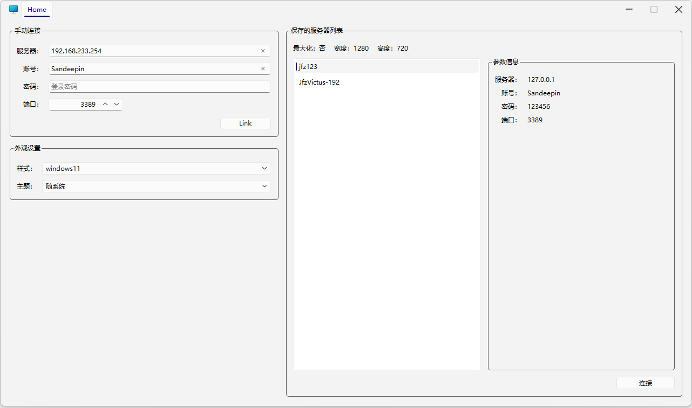

# JfzQtRDP

基于C++、Qt6、QWindowKit开发的RDP远程桌面管理小工具

之前做过[JfzRDP](https://github.com/jiangfangzheng/JfzRDP)，想测下AI发展怎么样了，突发奇想基于AI用Qt再复刻一个RDP小工具，哈哈。

### 截图



## 项目概述

JfzQtRDP 是一个基于 **Qt 6 Widgets + QWindowKit + Windows RDP ActiveX（mstscax.dll）** 的 Windows 远程桌面客户端。

界面使用 Qt 原生样式，支持 `windows11`、`windowsvista`、`windows`、`fusion` 样式切换；Windows 11 上默认 `windows11`，其他系统默认 `windowsvista`。支持明亮、暗黑、随系统主题，没有使用任何 QSS/CSS 美化。窗口标题栏由 QWindowKit 接管，标题栏里放置了标签页和自定义窗口按钮。

主要功能：

- 默认显示 `Home` 标签页。
- 手动连接：服务器、账号、密码、端口和 `Link` 按钮。
- 从 `server.json` 读取保存的服务器列表、最大化状态、宽度和高度。
- 保存的服务器列表：列表选择、右侧参数信息、`连接` 按钮。
- 新连接在标题栏新建标签页，标签页名称取 `ServerName`（手动连接时取服务器地址）。
- 重复连接不会新建标签页：同一个 `ServerName`，或相同“服务器 + 账号 + 端口”的手动连接，会直接切换到已有标签页。
- 当前选中的标签页使用系统强调色文字，并在标签底部显示强调色短下划线，便于区分。
- Home 页支持切换 Qt 样式：`windows11`、`windowsvista`、`windows`、`fusion`；Windows 11 默认 `windows11`，其他系统默认 `windowsvista`。
- 支持明亮、暗黑、随系统三种主题，可即时切换。
- 鼠标中键点击 RDP 标签页：弹出断开确认框，默认焦点在“否”；确认后断开连接并关闭标签页。
- 右上角关闭按钮弹出退出确认框，默认焦点和默认按钮均为“否”。
- RDP 意外断线后自动重连 3 次，仍失败则显示断开提示。
- `Maximized=false` 时窗口和 RDP 区域锁定为配置的 `Width`、`Height`；`Maximized=true` 时启动最大化，RDP 画面铺满标签页区域。

## 直接运行

双击 `JfzQtRDP.exe` 即可运行。程序第一次启动时，如果 `server.json` 不存在，会在 **JfzQtRDP.exe 同一目录** 生成默认配置。默认配置包含示例中的 `jfz123` 和 `JfzVictus-192` 两项。

> 运行日志写入同目录的 `JfzQtRDP.log`，每次启动覆盖。日志中不会记录密码。

## 使用说明

### 手动连接

`Home` 页面左侧“手动连接”分组：

- 服务器：默认 `192.168.233.254`
- 账号：默认 `Sandeepin`
- 密码：默认空
- 端口：`1`～`65535`，默认 `3389`
- `Link` 按钮：打开新的 RDP 标签页；如果相同“服务器 + 账号 + 端口”的连接已经打开，则直接切换到已有标签页

手动连接没有 `ServerName` 字段，因此标签页名称使用服务器地址。

### 保存的服务器列表

右侧“保存的服务器列表”分组：

- 顶部显示从 `server.json` 读取的 `最大化：是/否  宽度：1920  高度：1080`
- 列表显示 `ServerName`
- 选中某一项后，右侧“参数信息”显示服务器、账号、密码、端口
- 点击“连接”按钮打开新的 RDP 标签页；同一个 `ServerName` 已经打开时，直接切换到已有标签页
- 列表项也支持双击连接

### 标签页操作

- 标题栏中的 `Home` 标签页不可关闭。
- RDP 标签页标题为 `ServerName`（手动连接为服务器地址）。
- 当前选中的标签页文字使用系统强调色，底部有强调色短下划线。
- 标签页高度与标题栏一致（32px），标签底边与 RDP 内容区贴合，不再保留额外空白间距。
- 重复连接判定：
  - 保存的服务器：按 `ServerName` 去重（忽略大小写和首尾空格）。
  - 手动连接：按“服务器 + 账号 + 端口”去重（忽略服务器/账号大小写和首尾空格）。
  - 手动连接如果与已打开的保存服务器指向同一“服务器 + 账号 + 端口”，也会复用已有标签页，避免两个相同 RDP 会话互相顶掉。
- 鼠标中键点击 RDP 标签页：弹出“断开连接”确认框，默认按钮和默认焦点均为“否”。
  - 选择“是”：断开该 RDP 连接并关闭标签页。
  - 选择“否”、按 `Esc` 或关闭对话框：保持连接和标签页。
- 关闭标签页前会调用 ActiveX 的 `Disconnect()`。

### 退出确认

点击标题栏右上角关闭按钮（或按 `Alt+F4`）会弹出“退出确认”对话框：

- 默认按钮：`否`
- 默认键盘焦点：`否`
- 选择 `是`：断开所有 RDP 连接并退出。
- 选择 `否`、按 `Esc` 或关闭对话框：继续运行。

### 窗口大小规则

配置项 `Maximized` 控制启动时的窗口状态：

- `Maximized: true`
  - 启动时最大化。
  - 忽略 `Width`、`Height` 作为 RDP 桌面尺寸，RDP 使用标签页实际可用区域。
  - 最大化时使用的 RDP 桌面尺寸例如 3840×2080（取决于屏幕工作区和标题栏高度）。
  - 本程序启用 `SmartSizing`，窗口尺寸变化时由 RDP 控件缩放画面填充。
- `Maximized: false`
  - 程序窗口固定，不能拖动边框调整大小，最大化按钮禁用，双击标题栏也不会最大化。
  - 标签页内容区域锁定为 `Width × Height`；窗口客户区高度为 `Height + 32`（32 为标题栏高度）。
  - 例如 `Width=1920, Height=1080` 时，RDP 区域为 1920×1080，窗口客户区为 1920×1112。

### 外观设置

`Home` 页左侧“外观设置”分组提供两个下拉框，修改后立即生效：

- 样式：
  - `windows11`（Windows 11 默认）
  - `windowsvista`（非 Windows 11 默认）
  - `windows`
  - `fusion`
- 主题：
  - `随系统`（默认）
  - `明亮`
  - `暗黑`

说明：

- 样式使用 `QStyleFactory` 在运行时切换。
- 主题使用 `QStyleHints::setColorScheme()` 和自定义 `QPalette` 切换。
- 暗黑主题下，`windows11`、`windows` 和 `fusion` 样式使用深色调色板。
- `windows11`、`windows`、`windowsvista` 明亮模式下，主窗口背景统一使用 Win11 原生浅色 `#F3F3F3`，不再出现经典 `#D4D0C8` 灰色。
- `WindowsVista` 使用原生浅色控件，不支持真正的暗黑配色；选择暗黑时会自动使用 `Fusion` 绘制，并在“外观设置”中显示提示。
- 标题栏颜色、标签页强调色和窗口边框会随主题同步更新。
- 外观设置是运行时设置，不写入 `server.json`；重启后恢复系统对应的默认样式（Win11 为 `windows11`，其他系统为 `windowsvista`）和“随系统”主题。

## server.json

文件位置：与 `JfzQtRDP.exe` 同目录。

默认生成内容示例：

```json
{
    "Width": 1920,
    "Height": 1080,
    "Maximized": false,
    "ServerList": [
        {
            "Password": "123456",
            "Port": 3389,
            "Server": "127.0.0.1",
            "ServerName": "jfz123",
            "UserName": "Sandeepin"
        },
        {
            "Password": "1",
            "Port": 3389,
            "Server": "192.168.233.168",
            "ServerName": "JfzVictus-192",
            "UserName": "Sandeepin"
        }
    ]
}
```

字段说明：

| 字段 | 类型 | 说明 |
| --- | --- | --- |
| `Maximized` | bool | 是否启动最大化 |
| `Width` | int | 非最大化时 RDP 标签页内容宽度 |
| `Height` | int | 非最大化时 RDP 标签页内容高度 |
| `ServerList` | array | 保存的服务器列表 |
| `ServerName` | string | 标签页显示名称 |
| `Server` | string | 服务器地址或主机名 |
| `UserName` | string | 登录账号 |
| `Password` | string | 登录密码（按需求明文保存） |
| `Port` | int | RDP 端口，1～65535 |

说明：

- 如果文件不存在，程序自动生成默认文件。
- 如果 JSON 格式错误，程序使用默认配置启动，并弹窗提示；不会覆盖原文件。
- `Port` 超出范围时会夹紧到 1～65535。
- `Width`、`Height` 会限制在 320～16384、240～16384 的安全范围内。

### 编译

先从 https://github.com/stdware/qwindowkit 下载qwindowkit，放到项目根目录的 qwindowkit/ 文件夹下。

在项目根目录用PowerShell 7执行：

```powershell
.\scripts\build.ps1 -Clean
```

脚本会完成：

1. 检查 QWindowKit 依赖（缺 qmsetup 时自动 clone，并更新其子模块）。
2. 以静态库方式编译并安装 QWindowKit 到 `third_party/QWindowKit`。
3. 使用 MinGW + Ninja 编译主程序到 `build/`。
4. 复制 exe 到 `output/`，执行 `windeployqt` 并补齐 MinGW 运行库。

如果 QWindowKit 已编译好，可以省略 `-Clean`。

## 已知限制

- 只支持 Windows。RDP 控件依赖系统的 `mstscax.dll`。
- 按需求，`server.json` 中的密码是明文。
- 隐藏了 ActiveX 自带连接栏，因此断开/重连状态使用本程序自己的横幅/失败页提示。
- `SmartSizing` 会按控件大小缩放远程画面；如果远程桌面和标签页宽高比不同，可能出现黑边，这是 RDP 缩放行为。
- `WindowsVista` 样式不支持真正的暗黑原生控件，暗黑主题下程序会自动使用 `Fusion` 绘制并显示提示。
- 外观设置不会持久化；重启后 Windows 11 恢复 `windows11 + 随系统`，其他系统恢复 `windowsvista + 随系统`。
- 程序不会自动修改 `server.json`；修改配置后需要重启程序生效。
- 日志文件为 `JfzQtRDP.log`，位于 exe 同目录。
